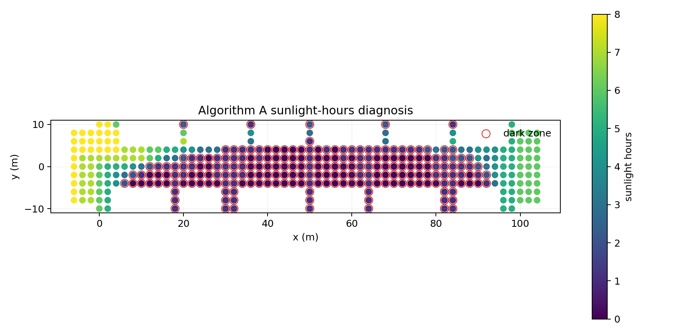
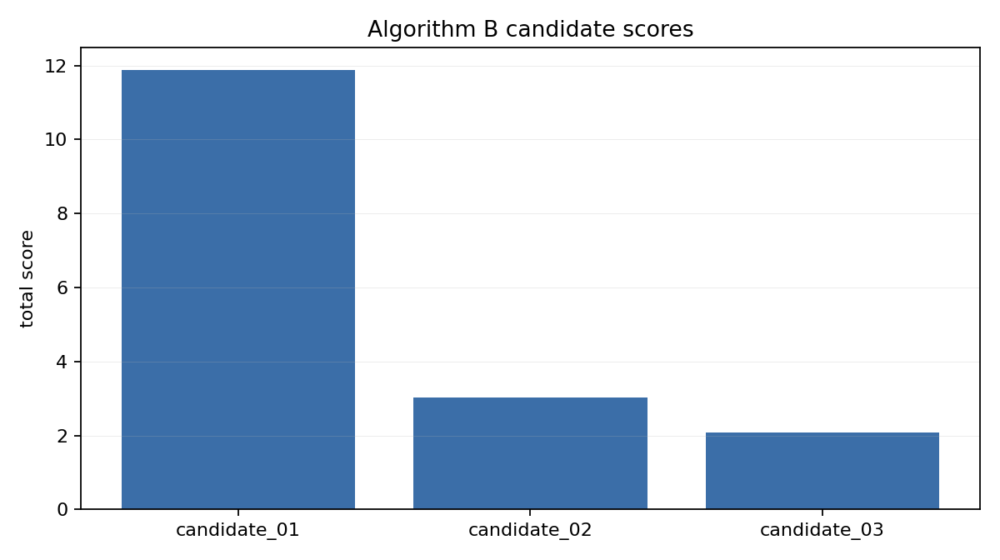
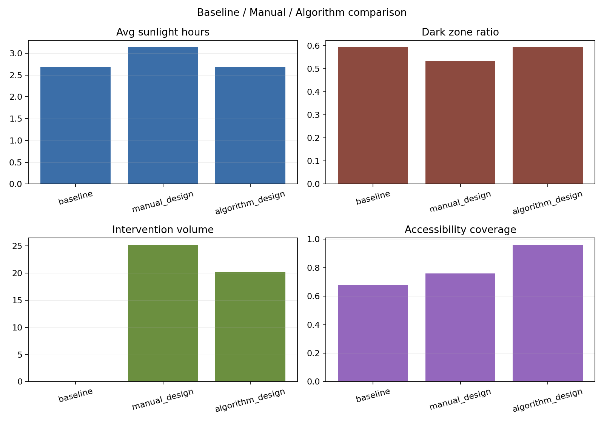

# Light Right Repair — Solar-Access Screening for Urban Renewal

**A screening workflow that helps architects shortlist building interventions that bring sunlight back to dense urban blocks — before anyone pays for full simulation.**

In the Guankou, Xiamen case study behind this work, a Python screening program scored 630 two-building intervention candidates on low-sunlight-area reduction, mean direct-sun gain, and intervention volume. A shortlist was then rechecked with Honeybee/Radiance, and the screening ranking agreed with the detailed simulation at Spearman ρ = 0.883 across 23 curated candidates. An abstract of this work was accepted at the 8th IRCHST 2026.

This repository is the public-safe demo of that workflow — the same three-stage pipeline (diagnose → generate candidates → validate) running on a toy dataset. Real site data, raw modeling files, and the full research archive are not published.



## Product Positioning

This project is best understood as an **AI-assisted spatial decision prototype**, not a final daylight-engineering tool. It turns a spatial justice question - which parts of a dense block remain under-lit, and what small interventions could improve them - into a repeatable product workflow:

```text
site geometry + planning rules -> diagnosis -> candidate generation -> safety validation -> design-team recommendation
```

The intended user is a designer, planner, or urban-renewal researcher who needs an early-stage decision aid before committing to detailed manual modeling.

## What It Does

The prototype runs a three-stage spatial decision workflow:

1. **Algorithm A - Diagnosis**  
   Simulates winter sunlight exposure on a simplified block model, identifies dark zones, and generates diagnostic heatmaps.

2. **Algorithm B - Candidate Generation**  
   Generates small intervention candidates under a minimal-intervention principle.

3. **Algorithm C - Validation**  
   Checks candidate interventions against accessibility and safety rules, then produces a final recommendation.

## AI Product Loop

| Product layer | Current implementation |
| --- | --- |
| User input | Toy block dataset or standalone grouped OBJ massing model |
| Processing | Simplified 2.5D sunlight diagnosis, candidate generation, rule-based validation |
| Output | Dark-zone heatmap, candidate scores, before/after metrics, final recommendation |
| Validation | Post-simulation ranking, accessibility and safety screening, manual caveat notes |
| Human feedback | Designer reviews recommendation, adjusts geometry/rules, and reruns the workflow |

## Why It Matters

Light quality is a spatial justice issue in dense urban renewal. Instead of treating sunlight analysis as a final rendering check, this workflow treats it as an iterative design decision layer:

- where are the dark zones?
- which public-space gaps can be repaired with minimal intervention?
- which candidate improves light while preserving safety and accessibility?
- how can a designer compare algorithmic suggestions with manual design judgment?

## Public Demo Scope

Included:

- Python pipeline code
- public toy street dataset
- sample configuration files
- generated demo outputs
- heatmap and comparison figures

Excluded:

- real site data
- raw CAD/DXF/SKP/OBJ project files
- field photos and survey materials
- private group/team documents
- course or review materials
- real project output folders

## Quick Start

Install dependencies:

```bash
pip install -r requirements.txt
```

Run the public toy demo:

```bash
python main.py --dataset sample_toy_street --output-dir outputs/demo_run
```

Regenerate the toy dataset and run:

```bash
python main.py --dataset sample_toy_street --regenerate-toy --output-dir outputs/demo_run
```

Run with candidate post-simulation verification:

```bash
python main.py --dataset sample_toy_street --regenerate-toy --verify-candidates --output-dir outputs/demo_verified
```

Validate a standalone OBJ massing model:

```bash
python main.py --obj examples/single_mass_block.obj --overwrite-obj-dataset --diagnosis-only --output-dir outputs/single_mass_check
```

Standalone OBJ validation is useful for early testing, but it is not a reliable urban-design conclusion until roads, protected zones, accessibility nodes, and building IDs are manually checked. A single massing block should usually use `--diagnosis-only`; full A/B/C optimization is more meaningful when the OBJ contains several grouped buildings plus site context.

## Repository Map

- `main.py` - command-line entry point for the A/B/C workflow
- `src/algorithm_a_diagnosis/` - sunlight diagnosis and dark-zone detection
- `src/algorithm_b_optimization/` - candidate generation and scoring
- `src/algorithm_c_validation/` - safety and accessibility validation
- `src/geometry/` - toy geometry and intervention mesh helpers
- `src/solar/` - simplified sun-path and sunlight simulation
- `src/visualization/` - heatmap and comparison chart generation
- `data/sample_toy_street/` - public toy dataset
- `config/` - public demo settings
- `outputs/demo_run/` - generated demo outputs
- `assets/figures/` - selected figures for README/portfolio review
- `docs/` - project positioning and privacy notes
- `examples/` - small public-safe geometry examples for validation

## Demo Figures

### Diagnosis Heatmap


### Candidate Scores



### Before / After Comparison



## Status

Public-safe research prototype release. It is ready to show as a v0.1 AI product prototype, with transparent limitations and an upgrade path toward a richer design-review interface.

The private project archive remains offline and is not published.

## Product Documents

- [PRD-lite](docs/PRD-lite.md)
- [AI product flow diagram](docs/AI_PRODUCT_FLOW_DIAGRAM.md)
- [AI decision pipeline](docs/AI_DECISION_PIPELINE.md)
- [Evaluation metrics](docs/EVALUATION_METRICS.md)
- [Standalone OBJ validation guide](docs/SINGLE_MASS_VALIDATION_GUIDE.md)
- [中文产品定位说明](docs/PRODUCT_POSITIONING_CN.md)
- [Interview talking points](docs/INTERVIEW_TALKING_POINTS.md)
