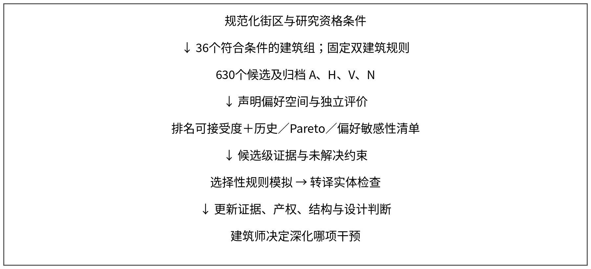

# 面向城市更新的日照干预筛选与偏好敏感性决策支持

## 摘要

既有城市街区日照不足的问题，需要一种同时呈现环境收益与决策假设的干预筛选方法。我们整合一个简化场地中630个双建筑减高候选的三轮归档实验：固定评分与Pareto筛选、偏好遗憾分析，以及事先冻结的日照优先比较。面积收益、平均直接日照增益和名义移除体积区分候选；在整个规则全集中，新增低日照面积均为零。历史45/35/15/5权重由研究者声明，未经过专家验证。十候选遗憾启发式将完整单纯形中的平均效用遗憾从0.010759改善至0.000054，但历史清单在有序与局部优先目标下原本已是零遗憾。第三轮的六个情境均未通过完整的预先登记替换规则。总日照权重情景提高了最优候选覆盖率，包括Solar70中的89.08%提升至100%，但恢复率增益仍低于0.02，部分清单也未满足日照收益保护条件。新的备选方案还暴露了Honeybee复核缺失。选择性模拟与包含性检查保持为不同证据层。研究贡献是应用层面的决策模型、可解释的偏好敏感性工作流及可追溯的分层验证，而不是新的通用算法或可直接施工的建议。AI辅助使用另行披露[9]。

关键词：决策支持；偏好敏感性；日照；多准则分析；城市更新。

## 1 引言

本节有AI辅助准备[9]；范围见AI使用披露。

城市更新可以在限制既有建筑干预的同时缓解日照不足。在详细设计之前，建筑师需要数量可管理的备选方案，以及关于这些方案为何被保留的清楚说明。仅按模型日照增益排名会忽略干预负担；把加权评分当作权威答案，又会隐藏它所代表的优先目标。本研究的任务是早期决策支持：识别有潜力的减高方案，揭示偏好依赖并引导后续复核，同时把设计选择留给建筑师。

我们考察一个简化城市街区，包含45个规范化建筑组、36个符合研究条件的组，以及固定减高规则下全部630个无序双建筑对。四个指标表达决策依据：低日照面积减少量（$A$）体现阈值不足的缓解；平均直接日照增益（$H$）体现不局限于阈值跨越的日照改善；名义移除体积（$V$）近似表示干预规模；新增低日照面积（$N$）标记不利影响。历史评分给这些指标的权重依次为45%、35%、15%和5%。它们是研究者的固定选择，既不是通过调查获取的专家权重，也不是层次分析法结果。由于整个规则全集中$N=0$，其贡献为常数。

本文整合三轮既有研究，没有新增实验。第一轮建立有限筛选、历史Top10/Pareto备选方案、选择性模拟复核与几何检查。第二轮检验广泛、有序及局部权重空间中的名次可接受度和遗憾。第三轮询问：日照优先清单能否在满足事先冻结的保护条件时，保留更多偏好特定前十名方案。各轮回答不同问题：保留一个最佳机会不等于保留许多高排名方案；广泛偏好不确定性也不等同于日照优先的项目任务书。

本文贡献包括：（1）有限且明确的日照干预决策模型，以及可解释的$A/H/V/N$语义；（2）在相同复核预算下比较、保留负面结果的偏好敏感性筛选工作流；（3）区分规则评价、选择性专业模拟及转译几何的可追溯验证结构。数学组成部分均已有先例。本文不声称提出新的通用算法、经过验证的专业偏好模型，或观察到了建筑师决策质量的改善。

证据支持有条件的机会保留，而非无条件替换方法。广泛空间中的遗憾有所改善，但历史清单在有序和局部空间中原本就是零遗憾。第三轮全部六个情境都未通过完整替换门槛，尽管总日照空间中的最优候选覆盖率有所提高。所有偏好分析均复用归档绩效，没有新增Honeybee/Radiance运行、场地观测或建筑师调查。

## 2 相关研究与方法定位

本节有AI辅助准备[9]；范围见AI使用披露。

### 2.1 不确定偏好与代表性子集

SMAA-2[6]将随机多准则可接受度分析扩展到各个名次，使分析者能够在权重空间中检查方案，而不是只选择一个权重向量。用Monte Carlo方法近似这些可接受度积分，是已有实现方式[11]。我们采用这一思想的受限形式：准则值固定、权重分布明确声明。本研究没有实现不确定绩效分布、中心权重向量或置信因子，也不把可接受度等同于真实建筑师喜欢某候选的概率。

稳健序数回归[4]则保留符合决策者比较判断的一组加性价值函数，并区分必要偏好与可能偏好。本研究没有此类比较判断。因此，权重限制是研究情景，不是拟合得到的序数回归模型。这也避免了把采样中一致的排名误认为连续域上的必要偏好。未来可通过真实建筑师判断约束允许的模型集合，但本研究尚无这一证据。

最小最大遗憾将一个决策的效用与兼容效用函数下的最佳可行方案比较。Boutilier等[1]针对该准则发展了优化和偏好获取方法。我们的输出是供以后选择的子集，而不是一次不可逆的单一选择。遗憾最小化代表性数据库研究[7]已形式化描述：用固定大小子集的最佳效用逼近整个数据库的最佳效用。其相对遗憾设定和算法保证，不能转移到本研究的绝对归一化损失或贪心实现。因此，我们不声称发明了基于遗憾的子集选择或权重空间探索。

### 2.2 建筑与环境决策支持

建筑性能优化已有关于多目标设计、计算效率、不确定性和应用障碍的广泛研究[8]。EvoMass[12]将基于优化的建筑体量探索与类型解释、设计者重新配置相联系，范围比本研究的固定干预规则更广。它提供建筑领域背景，但其用户研究证据不能验证我们的工作流或偏好假设。本研究不声称首次提出建筑师参与的优化过程。

太阳性能评估还涉及不同物理量。城市太阳能与天然采光可用性研究[2]，以及太阳能规划指标分类[3]，提示我们必须准确命名结果。本研究的直接日照时长和阈值面积，不是室内照度、全年辐照或法规符合性。Ladybug[10]、Radiance[13]和pvlib[5]提供软件工具背景，不保证此案例的输入几何或模拟配置准确。决策支持分析位于快速有限枚举与选择性专业复核之间：在偏好尚未确定时，决定哪些模型备选方案仍应进入建筑师视野。

## 3 有限干预模型与性能证据

本节有AI辅助准备[9]；范围见AI使用披露。

### 3.1 候选全集

令建筑集合B包含45个规范化建筑组，每组具有足迹Fi和高度hi。子集E包含36组：满足归档的可移动/受保护标志，经严格布尔解析，且高度大于3米。一个规则决策恰好选择两组：

$$
z_i\in\{0,1\}\ (i\in E),\quad \sum_{i\in E}z_i=2,\quad z_i=0\ (i\notin E).
\qquad (1)
$$

被选中建筑的高度由以下规则固定：

$$
h_i^r=\max\{3,h_i-\min(3,0.25h_i)\},\qquad
 h_i(z)=(1-z_i)h_i+z_i h_i^r.
\qquad (2)
$$

所有足迹和未选中建筑的高度保持不变。因此，决策全集D包含C(36,2)=630个唯一无序建筑对。符合条件是研究约束，不是产权许可、遗产保护审批或结构适宜性的证明。这些是规则备选方案，不是已经完成的建筑设计。

规范化足迹是DXF构件包围盒的并集。共享构件、足迹重叠及与归档OBJ表示的不一致，限制了物理保真度。保留此输入版本，是为了让偏好比较使用相同绩效。修改边界或资格条件将定义新的实验；本研究的穷举不能证明在声明全集之外的最优性。

### 3.2 日照采样与指标

案例在规范化足迹外部且不处于边界的位置，设置2,031个接收点，网格间距3米，高度0.1米。纬度24.55°N，经度118.03°E，UTC+8时区，北向假定为零。保存的pvlib序列采用2026年12月21日，作为接近冬至的设计日情景。16个采样中心由08:15到15:45，间隔半小时；每个采样权重为0.5小时，总权重8小时。这是采样直接日照，不是观测天气，也不是证明全年最不利的一天。

令太阳高度角为αt，遮挡指示量为bjt(z)，有效太阳指示量为dt=1{αt>0}，则日照时长为：

$$
D_j(z)=\sum_{t=1}^{16}0.5\,d_t[1-b_{jt}(z)].
\qquad (3)
$$

2.5D计算基元取投影水平射线与足迹的第一个正向交点距离$\ell$，比较0.1+ℓtanαt与建筑高度。小于等于10⁻⁷米的距离被忽略，高度容差为10⁻⁹米。所有冻结采样的太阳均在地平线之上。因此，历史实现中把地平线以下无遮挡项计入的潜在问题，并不反驳这些冻结值；扩展分析必须保留显式有效太阳掩码。

以Dj⁰表示基线时长，P=2031，a=9平方米，τ=3小时，归档指标定义如下：

$$
A(z)=a\sum_j[\mathbf{1}\{D_j^0<\tau\}-\mathbf{1}\{D_j(z)<\tau\}],\qquad (4)
$$

$$
H(z)=P^{-1}\sum_j[D_j(z)-D_j^0],\qquad (5)
$$

$$
V(z)=\sum_i|F_i|[h_i-h_i(z)],\qquad (6)
$$

$$
N(z)=a\sum_j\mathbf{1}\{D_j^0\geq\tau,\ D_j(z)<\tau\}.\qquad (7)
$$

A是净低日照面积减少量；H是平均直接日照增益；V是名义加总移除体积；N是新增低日照面积。足迹重叠使V不同于整个场景实体并集体积的减少量，也不同于经过核验的实际拆除量。阈值是研究定义，不是法定要求。

表1：冻结的完整全集归一化边界。印刷值经过舍入，计算使用归档精度。

| 指标 | 最小值 | 最大值 | 单位 |
| --- | --- | --- | --- |
| $A$ | 0 | 396 | m$^2$ |
| $H$ | 0 | 0.0635155096 | h |
| $V$ | 387.382435 | 10,891.474418 | m$^3$ |
| $N$ | 0 | 0 | m$^2$ |

全部630条记录严格满足N=0，与固定足迹的纯减高一致。在规则向几何转译时，错误添加实体可能产生新遮挡，因此N仍然重要；它只从有效偏好区分维度中移除。有210个候选的A=0，新排名及遗憾分析没有默默删除它们。A与H的Pearson相关系数为0.640978，采用并列平均秩的Spearman系数为0.768360。两项指标相关但不可互换：A统计跨越阈值的变化，H也包含未跨越3小时阈值的变化。我们保留两者，同时承认对两项都赋权意味着对相互重叠的日照收益作出特定价值判断。

### 3.3 历史评分与有效效用

每个原始指标q使用表中不变的完整全集边界：

$$
n_q=\begin{cases}(q-q_{\min})/(q_{\max}-q_{\min}),&q_{\max}-q_{\min}\geq10^{-12},\\0,&\text{其他情况}.\end{cases}
\qquad (8)
$$

历史评分及有效偏好中心为：

$$
S_i=0.45n_{A,i}+0.35n_{H,i}+0.15(1-n_{V,i})+0.05(1-n_{N,i}),\qquad (9)
$$

$$
x_i=(n_{A,i},n_{H,i},1-n_{V,i}),\quad u_i(w)=w^\top x_i,\qquad (10)
$$

$$
w^0=(9/19,7/19,3/19),\qquad S_i=0.95u_i(w^0)+0.05.\qquad (11)
$$

最后的等式在不验证权重的前提下保持历史排序。Historical10完整保留归档前十名：先按S降序，再按A和H降序，并要求A>0。历史评分没有精确并列。未经筛选的偏好分析使用全部630个候选、固定归一化和效用u，既不把u重新标为历史S，也不按选中的候选重新拟合边界。

## 4 偏好敏感性方法 广泛与局部优先目标

本节有AI辅助准备[9]；范围见AI使用披露。

### 4.1 三个声明的偏好空间

协议、输入哈希、采样规则、数量、随机种子、选择目标和评价标准，在计算新排名结果之前已提交冻结。三个闭支持域定义为：

$$
W_F=\{w\in\mathrm{R}_+^3:w_A+w_H+w_V=1\},\qquad (12)
$$

$$
W_O=\{w\in W_F:w_A\geq w_H\geq w_V\},\qquad (13)
$$

$$
W_L=\{w\in W_F:|w_j-w_j^0|\leq0.10\ \text{对所有 }j\}.\qquad (14)
$$

$W_F$表示在所选线性模型中不增加其他偏好限制。$W_O$是日照优先研究情景，不是建筑师已确认的偏好。$W_L$用声明的坐标半宽，检验历史中心附近的情况。半径0.10是协议选择，不是估计得到的人类判断容差。

每个空间产生20,000个训练权重、20,000个独立测试权重及20,000个独立重复权重，总计180,000个保留样本。完整单纯形样本服从IID Dirichlet(1,1,1)，按单纯形面积均匀分布。有序空间把这些可交换分量降序排列，从而在有序扇区内按面积均匀分布。局部空间拒绝不符合限制的Dirichlet样本，按生成顺序保留合格样本，而不是对各坐标独立扰动后重新归一化。计算使用NumPy PCG64和float64。按完整、有序、局部的顺序，训练种子为2026101801–03，测试为2026101811–13，独立重复为2026101821–23。局部提议每批100,000个，直至保留20,000个合格样本。

### 4.2 排名、可接受度与稳定性

对每个采样权重，全部630个效用按未舍入float64值降序排列。数值完全相同的并列，按建筑对自然数字标识升序打破。以ri(w)表示排名，名次可接受度和前十名可接受度估计为：

$$
\widehat b_i^r=M^{-1}\sum_{m=1}^M\mathbf{1}\{r_i(w_m)=r\},\qquad
 \widehat b_i^{\leq10}=\sum_{r=1}^{10}\widehat b_i^r.
\qquad (15)
$$

第一名可接受度为$\widehat b_i^1$。每个候选、每个数据划分均保留完整名次直方图、平均名次和最差观测名次。最后一项明确只是观测统计量，不是最坏可能名次。前十名成员稳定性将每个权重的前十集合T(w)与Historical10比较，使用Jaccard重合率|T(w)∩SH|/|T(w)∪SH|。

边际95% Wilson区间描述在指定分布条件下候选比例的Monte Carlo精度。20,000次IID抽样的最大二项标准误约0.00354；它既不保证630个方案的同时置信覆盖，也不表示几何或用户不确定性。区间同时附有独立种子的差异、精确及近似并列诊断，以及全部空间结果。确定性排序可复现，但不能让等效候选在实质上变得不同。因此，我们同时评价按效用和按候选身份定义的最优覆盖率。

### 4.3 十候选选择目标

对非空清单S⊂D，定义其最佳可实现效用和绝对遗憾：

$$
B(S,w)=\max_{s\in S}u_s(w),\qquad R(S,w)=\max_{i\in D}u_i(w)-B(S,w).
\qquad (16)
$$

在冻结的归一化效用下，遗憾处于[0,1]。它是绝对效用损失，不是移除体积、日照面积的百分比，也不是相对遗憾比值。有限情景目标问题为：

$$
\min_{S\subset D,\ |S|=10}\ \max_{w\in W_{\mathrm{train}}}R(S,w),
\qquad (17)
$$

Wtrain串联了60,000个训练样本。我们采用名为Robust10的贪心启发式。从最佳效用零开始，每步选择使最大训练遗憾最小的剩余候选。完全并列时，先选择等权训练池平均遗憾较低者，再按自然建筑对标识判定。过程始终添加十个候选。它没有全局求解上述组合优化问题，没有交换之前的选择，也没有利用评价结果。

### 4.4 对照与评价

Historical10是不变基线。AV10从完整A/V Pareto前沿中，取历史名次最高的十项，目标为最大化A、最小化V；AHV10同样从A/H/V前沿中取十项。支配要求在所有指定目标上不差，且至少一个目标严格更好。两个前沿均基于全部630候选计算。完整前沿另行作为诊断集合评价，保留实际数量。按历史名次压缩是刻意采用的简单、依赖偏好的规则，不宣称是最好的Pareto子集方法。

每个十候选集合都用完全相同的独立情景评价。报告平均、中位数、第95百分位及最大观测遗憾、最佳效用、最优覆盖率、至少一个前十候选覆盖率，以及平均前十恢复率：

$$
C(S)=M^{-1}\sum_m\mathbf{1}\{R(S,w_m)\leq10^{-12}\},\qquad
 Q(S)=M^{-1}\sum_m\frac{|S\cap T(w_m)|}{10}.
\qquad (18)
$$

C按效用判断最优覆盖并兼顾并列；身份覆盖则检查确定性第一名是否在集合中。Q奖励保留多个高排名候选，即使它们绩效相似。单一指标无法涵盖这两个不同决策目标。

对Robust10与各同预算对照，计算配对情景遗憾差的Monte Carlo标准误及均值差的正态95%区间。测试与独立重复保持分开，两者都不是新场地样本。确定性网格包含所有非负整数坐标(i,j,100−i−j)/100，共5,151个权重，再分别按支持域限制。它包含IID内部抽样几乎必然遗漏的边界。网格结果是压力检查，不是IID置信样本。

### 4.5 固定集合的连续最坏情况审计

独立审计避免把最大采样遗憾当作上界。对固定集合S、空间W及每个候选i，求解：

$$
g_i(S,W)=\max_{w,t}t,
$$

约束条件为：

$$
w\in W,\quad t\leq w^\top(x_i-x_s)\quad(\forall s\in S).\qquad (19)
$$

于是有：

$$
\max_{w\in W}R(S,w)=\max_{i\in D}g_i(S,W).
\qquad (20)
$$

原因是R(S,w)=maxi mins wᵀ(xi−xs)；有限/紧集上的两次最大化可交换，辅助变量表示内部最小值。各空间是多面体，因此每个候选对应的小问题都是线性规划。这证明的是固定集合的形式化评价，不是集合构建的最优性。

SciPy的HiGHS接口使用10⁻⁹的原始和对偶可行性容差。每个集合/空间的全部630个候选规划均须成功。检查见证权重是否满足支持域约束，并直接重新计算遗憾，要求在10⁻⁸内一致。连续最大值应在该容差内不小于样本和网格最大值。原始输出保留数值负零，报告时可写为零。没有任何LP结果反向用于选择候选。

## 5 广泛与局部偏好结果

本节有AI辅助准备[9]；范围见AI使用披露。

### 5.1 偏好特定的排名并非处处稳定

A/V前沿有12个候选，A/H/V前沿有41个。这一区别很重要：某方案在面积和体积上被支配，但仍可能提供有价值的平均日照增益。如果把全部分析限制在二目标前沿，就会在考虑权重前丢弃这些机会。因此，名次统计保留完整630候选。

历史前十名成员在WF中的稳定性，明显低于接近历史优先目标时的稳定性。完整、有序、局部空间的平均测试Jaccard重合率分别为0.403450、0.819045、0.832001。完整空间中位数为0.428571，第五百分位为零；有序和局部中位数均为0.818182。这些统计把局部稳定与全局权重不敏感区分开：在某邻域中稳定，不能证明在体积或日照时长主导时仍然一致。

C9/C24在有序与局部权重下是唯一被采样到的第一名，但在完整空间中的第一名频率为0.4249。历史名次为397的C25/C29因具有最小名义体积而有用；C24/C35提供最大$H$。完整名次直方图仍保留在档案中。这些例子解释了广泛偏好分析为何改变成员，而不只是重新排列历史十项。

### 5.2 留出情景上的遗憾与覆盖

表2：独立测试评价，每空间20,000个权重，每集合十个候选。恢复率是保留每种偏好对应前十名的平均比例。

| 偏好空间 | 集合 | 平均遗憾 | 第95百分位 | 第一名比例 | 前十恢复率 |
| --- | --- | --- | --- | --- | --- |
| 完整 | Historical10 | 0.010759 | 0.080601 | 0.77695 | 0.51560 |
| 完整 | AV10 | 0.022996 | 0.138778 | 0.66215 | 0.26599 |
| 完整 | AHV10 | 0.010378 | 0.080601 | 0.83170 | 0.53123 |
| 完整 | Robust10 | 0.000054 | 0.000000 | 0.97940 | 0.42248 |
| 有序 | Historical10 | 0.000000 | 0.000000 | 1.00000 | 0.89618 |
| 有序 | AV10 | 0.000000 | 0.000000 | 1.00000 | 0.29140 |
| 有序 | AHV10 | 0.000000 | 0.000000 | 1.00000 | 0.74120 |
| 有序 | Robust10 | 0.000000 | 0.000000 | 1.00000 | 0.44342 |
| 局部 | Historical10 | 0.000000 | 0.000000 | 1.00000 | 0.89953 |
| 局部 | AV10 | 0.000000 | 0.000000 | 1.00000 | 0.28136 |
| 局部 | AHV10 | 0.000000 | 0.000000 | 1.00000 | 0.83615 |
| 局部 | Robust10 | 0.000000 | 0.000000 | 1.00000 | 0.53373 |

上表按相同十候选预算比较。在完整单纯形测试中，Robust10把平均遗憾从0.010759降至0.000054。历史集合的第95百分位为0.080601，稳健集合该百分位为零，因为超过95%的权重仍保留全局第一名。这不表示全部情景遗憾为零：稳健集合的最大测试观测遗憾为0.007539。在相同评价权重下，最佳可实现平均效用从0.809002升至0.819707。

最优候选覆盖率从0.77695升至0.97940；Robust10的边际95% Wilson区间为[0.977337,0.981278]。每个完整空间测试权重的前十名，至少有一个进入Robust10，而Historical10该比例为0.90045。测试汇总中，按身份和兼顾并列的最优覆盖率一致。这些是声明均匀权重测度下的频率，不是建筑师需求得到满足的人数百分比。

相同预算的Pareto变体并未消除对压缩规则的依赖。AV10平均遗憾0.022996，比Historical10更差，因为排除了有时长收益的方案。AHV10将平均遗憾略微改善至0.010378，最优覆盖率升至0.83170，但仍继承了历史评分对低体积极端方案覆盖不足的问题。其完整空间连续最大值与历史集合相同。这些对照说明，非支配性本身并未规定如何填满十个复核名额。

在有序与局部偏好下，四个十候选集合均达到零测试遗憾和完整最优覆盖，Robust10在这些指标上没有改善。这是有实质意义的结果：如果建筑师接受任一限制，针对完整空间增加多样性，对于此全集内保留最佳效用机会并非必要。团队不应仅因为方法名为“稳健”，就接受额外的复核负担。

### 5.3 负面结果：前十名恢复率下降

机会保留在另一结果上付出了明确代价。完整空间前十恢复率由Historical10的0.515600降至Robust10的0.422480；有序空间由0.896180降至0.443420；局部空间由0.899530降至0.533730。因此，稳健集合并不是每种偏好对应前十名的更忠实近似。它用几项接近中心、名次较高的方案，换取了保护其他偏好区域的方案。

### 5.4 连续审计、独立重复与采样误差

表3：固定集合连续最坏遗憾及完整空间网格最大值。全部候选专属线性规划成功。完整前沿是预算不相等的参考。

| 集合 | 数量 | 完整域LP | 完整域网格 | 有序域LP | 局部域LP |
| --- | --- | --- | --- | --- | --- |
| historical10 | 10 | 0.246359 | 0.246359 | 0 | 0 |
| AV10 | 10 | 0.232558 | 0.232558 | 0 | 0 |
| AHV10 | 10 | 0.246359 | 0.246359 | 0 | 0 |
| robust10 | 10 | 0.007656 | 0.007576 | 0 | 0 |
| AV full | 12 | 0.232558 | 0.232558 | 0 | 0 |
| AHV full | 41 | 0.000000 | 0.000000 | 0 | 0 |

连续审计确认，完整空间历史最大遗憾为0.246359，发生在纯体积顶点(0,0,1)。Robust10最大值为0.007656，见证权重约(0.211837,0,0.788163)，位于边的内部，竞争候选为C13/C29。只检查单纯形三个顶点，会遗漏这一稳健集合的最坏情况。网格最大值0.007576、测试最大值0.007539均低于连续值，符合预期。审计在数值容差内认证固定集合的损失，不认证全局最优十候选集合。

不限制数量的41项A/H/V前沿，在三个连续空间中均为零遗憾。这与非负线性效用一致：被支配候选不能独自改善最大值。但41个方案超过复核预算，因此它只是机会保留参考，不是公平十候选比较中的优势证据。不限制数量的12项A/V前沿，在纯时长偏好下仍有0.232558的完整空间最坏遗憾；多保留成员无法弥补遗漏的准则。

独立完整空间重复得到：Historical10平均遗憾为0.011351，Robust10为0.000055；最优候选覆盖率分别为0.76635和0.97885。测试划分上，配对的“稳健减历史”平均遗憾差为$-0.010705$，条件Monte Carlo 95%区间为$[-0.011132,-0.010279]$；独立重复结果为$-0.011296$及$[-0.011736,-0.010855]$。有序和局部独立重复中，两集合均保持零遗憾。因此，预先规定的“每个空间平均和第95百分位遗憾不增加，且至少一个空间严格改善”条件得到满足。这是在完整空间改善、另外两个空间相等，并非处处严格改善。

### 5.5 实际候选与证据状态

表4：按不变评分顺序列出的历史前十名。全部具有归档规则级Honeybee复核。C表示纠正转译；U表示复用未变化且包含的结果；—表示缺少转译验证。

| 名次 | 建筑对 | $A$ (m$^2$) | $H$ (h) | $V$ (m$^3$) | $S$ | 转译 |
| --- | --- | --- | --- | --- | --- | --- |
| 1 | C9/C24 | 396 | 0.04874 | 5551.3 | 0.84486 | C |
| 2 | C9/C15 | 351 | 0.03496 | 3127.8 | 0.75237 | C |
| 3 | C9/C12 | 306 | 0.04357 | 4030.5 | 0.73582 | -- |
| 4 | C15/C24 | 243 | 0.05367 | 4016.5 | 0.72005 | -- |
| 5 | C9/C35 | 297 | 0.04481 | 5303.3 | 0.71420 | -- |
| 6 | C9/C13 | 333 | 0.03028 | 2975.2 | 0.70832 | U |
| 7 | C12/C24 | 198 | 0.06228 | 4919.3 | 0.70350 | -- |
| 8 | C9/C21 | 333 | 0.03250 | 4252.0 | 0.70229 | -- |
| 9 | C9/C26 | 315 | 0.03520 | 3906.1 | 0.70170 | -- |
| 10 | C9/C27 | 324 | 0.03890 | 7340.9 | 0.68323 | -- |

表5：按贪心添加顺序列出的Robust10。HB：Y为归档规则复核，—为缺失。转译C表示归档包含性纠正，—表示缺少验证。保留历史名次供比较。

| 步骤 | 建筑对 | 历史名次 | $A$ | $H$ (h) | $V$ (m$^3$) | HB | 转译 |
| --- | --- | --- | --- | --- | --- | --- | --- |
| 1 | C9/C12 | 3 | 306 | 0.04357 | 4030.5 | Y | -- |
| 2 | C12/C15 | 20 | 153 | 0.04850 | 2495.7 | -- | -- |
| 3 | C12/C24 | 7 | 198 | 0.06228 | 4919.3 | Y | -- |
| 4 | C9/C24 | 1 | 396 | 0.04874 | 5551.3 | Y | C |
| 5 | C15/C25 | 125 | 99 | 0.02265 | 964.9 | -- | -- |
| 6 | C9/C15 | 2 | 351 | 0.03496 | 3127.8 | Y | C |
| 7 | C25/C29 | 397 | 18 | 0.00320 | 387.4 | Y | -- |
| 8 | C13/C15 | 55 | 135 | 0.03520 | 1440.3 | Y | -- |
| 9 | C24/C35 | 11 | 189 | 0.06352 | 6192.0 | -- | -- |
| 10 | C15/C24 | 4 | 243 | 0.05367 | 4016.5 | Y | -- |

两张表保留实际建筑对标识和绩效。Robust10与Historical10共有五项：C9/C24、C9/C15、C9/C12、C15/C24、C12/C24。新增C12/C15、C15/C25、C25/C29、C13/C15、C24/C35，移除C9/C35、C9/C13、C9/C21、C9/C26、C9/C27。集合Jaccard重合率为5/15=1/3。表中的贪心添加顺序不是新的固定权重排序。

Robust10中七项具有归档规则级Honeybee结果，三项没有：C12/C15、C15/C25、C24/C35。历史清单十项均有此复核。新清单因此扩展了需要验证的范围，而不是继承前一清单的全部复核。两项稳健成员C9/C24、C9/C15另有经Honeybee检查的包含性转译纠正结果；八项缺少归档转译设计验证。缺失证据仍是缺失，高可接受度或小遗憾不能替代验证。

## 6 日照优先比较与未通过的替换检验

本节有AI辅助准备[9]；范围见AI使用披露。

### 6.1 事先冻结的决策条件

第三轮归档研究询问：十个复核名额能否保留更多日照优先的高排名方案，同时不牺牲最优候选或过多日照收益？其协议在阈值数量、新权重抽样或结果出现之前冻结，不会追溯修改第二轮目标。除$W_O$外，两个空间限制体积系数：

$$
W_{70}=\{w\in W_F:w_A+w_H\geq.70\},\quad
W_{80}=\{w\in W_F:w_A+w_H\geq.80\}.\qquad (21)
$$

与$W_O$不同，这两个空间允许时长权重大于面积权重。两者都不构成严格按字典序进行的日照优化。这些边界由研究者声明。另有三个情境，将Solar70候选全集限制为$A\geq90$、180或270平方米，分别剩下166、50和12个候选。这些下限不是法律标准或通过调查获取的项目要求。完整全集的归一化保持不变。

每个主要空间各有20,000个训练、测试和独立重复权重，来自PCG64生成的Dirichlet(1,1,1)抽样。有序采样将可交换坐标排序；Solar70/80拒绝$w_V>.30/.20$的样本。训练、测试及独立重复种子依次为2026101901–03、2026101911–13和2026101921–23。分层情境复用Solar70数组，并非额外的独立样本。排序采用未舍入效用，平局由自然建筑对标识处理。评价结果不改变所选成员。

当$|S|=10$时，期望恢复率满足：

$$
Q(S)=\mathrm E\left[|S\cap T_{10}(w)|/10\right]
=\tfrac1{10}\sum_{i\in S}\Pr\{i\in T_{10}(w)\}.\qquad (22)
$$

因此，Coverage10选择训练前十名出现次数最多的十项，这是明确经验目标的精确模优化，而不是新的通用算法。平局依次按第一名次数、较小平均名次及自然标识处理。ProtectedCoverage10先纳入每个不同的训练第一名，再按同样顺序填满；若必选第一名超过十个，就宣布不可行。在观察到的全部六个情境中，两个选择器产生相同清单，因此没有证实额外保护约束的增量收益。

主要比较保持Historical10、Robust10、AV10及AHV10不变。筛选后比较明确采用适配：历史排序提供符合条件的成员；Robust10保留符合条件的原成员，再按历史名次补齐；Pareto清单在合格全集内重新计算前沿，按历史名次截取，必要时补齐。不会把这些适配版本悄悄重新称为原始清单。

完整替换门槛要求：测试与独立重复中的绝对恢复率增益均至少0.02；配对95% Monte Carlo区间下界为正；效用最优候选覆盖率损失不超过$10^{-4}$；平均或连续最坏遗憾的增加不超过$10^{-8}$；清单平均$A$和平均$H$都至少保留历史清单的95%。这些实际保护条件是冻结的研究选择，不是经过专家验证的阈值。观察结果后没有放宽条件。十个互不重叠的2,000权重训练块检查成员稳定性；经限制的5,151点网格及式（19）的固定集合LP独立审计遗憾。全部10,504个去重后的候选LP均成功求解，对应12,708个带标签的见证行。

### 6.2 条件性收益未满足完整门槛

表6：第三轮基于全部630候选的独立测试结果。C/P表示相同的Coverage10和ProtectedCoverage10清单。恢复率以比例表示，最优覆盖指效用最优候选覆盖率，最大遗憾为连续最大值。

| 空间 | 集合 | 恢复率 | 最优覆盖 | 平均$R$ | 最大$R$ |
| --- | --- | --- | --- | --- | --- |
| Ordered | Historical | .894950 | 1 | 0 | 0 |
| Ordered | Robust | .444360 | 1 | 0 | 0 |
| Ordered | AV | .290815 | 1 | 0 | 0 |
| Ordered | AHV | .741410 | 1 | 0 | 0 |
| Ordered | C/P | .899380 | 1 | 0 | 0 |
| Solar70 | Historical | .649650 | .89080 | .000750 | .019380 |
| Solar70 | Robust | .456385 | 1 | 0 | 0 |
| Solar70 | AV | .211580 | .68505 | .030440 | .232558 |
| Solar70 | AHV | .656835 | 1 | 0 | 0 |
| Solar70 | C/P | .660935 | 1 | 0 | 0 |
| Solar80 | Historical | .655725 | .84435 | .001073 | .019380 |
| Solar80 | Robust | .450710 | 1 | 0 | 0 |
| Solar80 | AV | .205810 | .68975 | .031419 | .232558 |
| Solar80 | AHV | .649560 | 1 | 0 | 0 |
| Solar80 | C/P | .669465 | 1 | 0 | 0 |

表6使用新的独立偏好样本，因而有序空间数值与表2略有差异。Historical10再次达到有序空间零遗憾。Solar70的最优候选覆盖率从89.08%升至100%，连续遗憾从0.019380降至零。Solar80的最优候选覆盖率从84.435%升至100%。这些是真实的条件性改善；不过，AHV10与之前的Robust10在两个空间中同样达到零遗憾。保留最优候选的收益并非新选择器独有。

表7：保护清单减去历史清单的恢复率差，包括配对测试Monte Carlo区间、独立重复增益及清单原始日照指标均值的变化。冻结的替换阈值要求两个独立划分中的增益均至少0.02。

| 情境 | 测试增益 | 测试95% MC区间 | 重复增益 | $A$变化 | $H$变化 |
| --- | --- | --- | --- | --- | --- |
| Ordered | 0.00443 | [0.00307, 0.00579] | 0.00381 | +3.20% | -8.23% |
| Solar70 | 0.01128 | [0.01001, 0.01256] | 0.01038 | -4.36% | +5.79% |
| Solar80 | 0.01374 | [0.00972, 0.01776] | 0.01477 | -11.92% | +18.13% |
| A90 | 0.01128 | [0.01001, 0.01256] | 0.01038 | -4.36% | +5.79% |
| A180 | 0.01350 | [0.01094, 0.01607] | 0.01164 | -7.85% | +9.68% |
| A270 | 0.00000 | [0.00000, 0.00000] | 0.00000 | +0.00% | +0.00% |

六个情境没有一个通过完整替换门槛。每个情境在两个独立划分中的恢复率增益均低于0.02（表7）。Ordered还损失约8.2%的清单平均$H$；Solar80损失约11.9%的清单平均$A$，并增加名义平均体积；A180损失约7.9%的平均$A$。Solar70和A90通过日照保护条件，但仍未达到恢复率阈值。狭窄的Monte Carlo区间不会使小幅条件性收益变成满足既定规则的实际成功。

清单均值描述的是提供给建筑师的备选菜单，不是十个同时实施的建设项目。它们是明确的保护条件；按情景选出的结果和单个候选的权衡仍然不同。Ordered用C9/C28替换C12/C24。Solar70用C24/C35替换C9/C27，从而纳入具有归档最大时长增益的候选。其平均面积收益下降4.36%，平均时长增益上升5.79%。这一项替换可以解释，但新成员缺少归档规则级Honeybee复核。Solar80新增三个未复核建筑对：C24/C35、C24/C27及C24/C26。Ordered中的C9/C28也缺少该复核。入选不意味着获得验证。

### 6.3 分层阈值与稳定性简要结果

A90排除464个候选，但没有改变历史清单或新Solar70清单成员。A180剩下50个候选，新清单与适配AHV10一致。A270剩下12个；适配Historical10、Robust10和两个新选择器成为相同十成员集合，测试恢复率为.996625，条件遗憾为零。适配AV10和AHV10仍然不同，各自恢复率为.900000。

对合格全集$D_c$，定义筛选损失$F_c(w)=\max_{i\in D}u_i(w)-\max_{i\in D_c}u_i(w)$。相对完整全集的总损失等于$F_c(w)+R_c(S,w)$。在A270下，仅筛选本身的平均测试损失约为.030440，最大观测损失为.228607。因此，出色的条件恢复率掩盖了在清单选择前已被排除的机会。没有任何下限被事后选为最佳政策。

保护清单在Ordered和A270的全部训练块中完全相同。Solar70/A90的平均“训练块清单相对完整训练清单”Jaccard重合率为.945455，Solar80为.893939，A180为.890909。这些是数值选择稳定性诊断，不是跨建筑师或跨场地重复验证。即使A270的历史适配清单，也包含未复核的C9/C28和C9/C20。阈值适配同时改变选择与证据负担。

## 7 与模拟及几何复核的整合

本节有AI辅助准备[9]；范围见AI使用披露。

### 7.1 具有独立证据关卡的决策工作流

预期流程从街区模型、明确资格条件和固定干预规则开始。快速日照计算产生完整指标表，偏好分析再产生名次分布及不同十候选清单。建筑师先检查其权衡和复核状态，再决定新增模拟或发展几何。下图把这些活动区分开。

图1：建议的决策支持流程。模拟与几何复核是分开的关卡；偏好实验既没有执行这些关卡，也没有观察建筑师使用流程。

{width=6.3in}

实践中的第一个讨论，是完整单纯形是否适用。如果项目团队排除体积主导权重，并接受wA≥wH≥wV，则结果已表明Historical10在该连续支持域中具有零固定集合遗憾。如果优先目标仍开放，Robust10保留更多机会，但团队必须为三个未复核规则候选及八个缺失转译安排后续复核。如果目的是提供多个相似且收益高的选项，前十恢复率可能比最优覆盖率更相关。界面应呈现这些选择，而不是显示一个不加限定的“最好”清单。

### 7.2 保留的选择性模拟证据

历史证据包含23个精选规则复核，以及与其不重合、预先冻结的20候选同场地覆盖队列。精选池结合历史前十、面积—体积前沿、历史案例与参考干预，属于目的性选择。覆盖队列按评分分层、体积和标识覆盖，在其报告的Honeybee结果之前选择，并不是跨场地随机抽样。本研究不重新选择其标识和结果。总共有43个已复核建筑对，约占全集6.83%，但按队列分别报告一致性。

表8：与归档Honeybee聚合结果的历史同指标比较，作为支持证据保留，不意味着新模拟。

| 队列 | 指标 | Spearman $\rho$ | MAE | 完全一致数 |
| --- | --- | --- | --- | --- |
| Curated23 | $A$ (m$^2$) | .999258 | .391304 | 22/23 |
|  | $H$ (h) | .991597 | .001177 | 3/23 |
|  | $S$ | .999012 | .006933 | 3/23 |
| Coverage20 | $A$ (m$^2$) | .997668 | .450000 | 19/20 |
|  | $H$ (h) | .999624 | .000295 | 9/20 |
|  | $S$ | 1.000000 | .002139 | 9/20 |

该表比较同类指标，而不是评分名次对面积名次。覆盖队列面积MAE为0.45平方米，是20个候选中一个9平方米差异的平均，不代表亚网格精度。评分相关系数为一，不意味着评分精确一致；只有九个覆盖评分完全相同。V在两条路线间共享，N为常数，进一步限制了复合评分比较的独立性。队列内前K名重合依赖并列处理，也不能建立全候选全集的召回率。

归档Honeybee/Ladybug有效射线不同于保存的pvlib射线。WEA载体使用恒定直接法向辐照1000瓦/平方米和水平散射辐照零，用于编码直接日照时数计算，不是实测气象。WEA及年内小时记录不含年份字段。因此，较高聚合一致性只是这些实际路线与设置的证据，不是完全相同天文输入实验，也不是全年环境性能验证。仅凭偏好分析使用的聚合证据，无法重新进行原始场地模拟。

### 7.3 历史效率与转译失败

历史匹配计时实验，在相同几何基元、射线和单线程条件下，比较重复求交与可复用建筑遮挡量。对选中建筑对(a,b)，以Oijt和Rijt分别表示原始、减高的遮挡指示量，计数更新为：

$$
C_{jt}^{(a,b)}=C_{jt}-O_{ajt}-O_{bjt}+R_{ajt}+R_{bjt},\quad C_{jt}=\sum_i O_{ijt}.
\qquad (23)
$$

使用足够宽的有符号整数类型，可保留未变建筑的贡献。全部12次规模/重复比较中，逐点和聚合等价性均通过。在630候选下，三次重复的中位数分别为重复求交11,608.183秒、复用24.037秒，后者包含准备计算，比值482.927。这只是两个实现的比较，没有带空间索引基线；既不是Honeybee加速，也不是建筑师工作时间的测量。

几何转译是独立风险。五个归档转译建筑对中，四个未通过实体包含性。历史C9/C24和C13/C24转译中，射线击中了原足迹外新增的上部墙体；两者各有四个接收点恶化、9平方米新增低日照面积。受控历史重放复现了六个场景可见矩阵，再分别模拟四个包含性纠正场景。C9/C13原本已包含，复用其未变化结果。这是十次历史场景运行，不是新的全候选模拟。

四项纠正消除了固定模型、射线及接收点上的观测不利可见性事件。C9/C24转译低日照面积减少量由342改为351平方米，而规则筛选值为396平方米。这些值描述不同对象，不能互换。C9/C15转译面积仍为342平方米，规则值为351平方米。修正包含性并没有使设计在体积上匹配，或等价于原始规则。

这一差别同样影响代价。C9/C24的名义规则体积为5,551.333立方米，规则实体并集减少量为5,470.406立方米，纠正转译并集减少量为5,474.582立方米。C6/C33对应数值为5,583.055、1,909.864和2,554.767立方米。重叠和转译形状变化使这些量显著不同。基于名义V的效用稳健性，无法建立基于其他数量的施工成本决策稳健性。

## 8 讨论、局限与可复现性

本节有AI辅助准备[9]；范围见AI使用披露。

### 8.1 面向建筑师的解释

主要决策是如何表达项目的日照不足与可接受的干预负担。Historical10是在声明评分下透明的默认复核清单，不是经过验证的专业共识。它在有序和局部偏好下达到零遗憾，因此没有依据声称在这些空间的该项指标上有所改善。当体积主导偏好确实可以接受时，广泛空间Robust10保护更多机会；但其主要情境中的平均面积收益为208.8平方米，而Historical10为309.6平方米。这种折中未必符合日照优先的任务书。

第三轮将有序优先与总日照强调区分开。Solar70允许时长主导偏好，提供一个可以解释的可选比较：在历史备选方案之外考察C24/C35。其最优候选覆盖率改善有用，但不会推翻完整替换检验未通过的结果。Solar80更高的名义日照总权重，同样不意味着整个清单具有更高面积收益。建筑师应在依赖清单前选择偏好条件，然后要求补齐模拟和几何证据。

贯穿三轮研究，实际输出是附有说明的选择集合，以及在其他优先目标下会发生哪些变化的记录。研究没有证明建筑师偏好某个集合、复核更快，或高评分干预具有法律及结构可行性。最终决定仍由专业人员作出，他们可以纳入简化模型未包含的产权、现有使用、施工和利益相关者判断。

### 8.2 有效性威胁

偏好模型：加性归一化效用假设面积、日照与体积可相互补偿。边界与单位塑造权衡。均匀单纯形面积、有序限制、局部半径及等权空间混合，都是未经建筑师偏好获取的研究选择。A与H相关，可能让日照改善拥有两条相关的影响通道。其他效用形式、否决条件或显式移除预算可能改变选择。结果不证明任何权重代表目标专业人群。

优化与评价：贪心构建依赖路径，并非全局最优。按历史名次压缩使AV10和AHV10成为有用且透明的基线，但它们不是经过强优化的子集竞争方法。研究缺少交换启发式、精确组合优化基准或更广泛预算搜索。独立LP审计仅评价所选支持域中的固定集合。Monte Carlo区间描述固定绩效条件下的抽样精度，不覆盖模型不确定性、多报告量选择效应或跨场地差异。

规范化几何与日照范围：构件包围盒并集不是核验过的实测足迹。共享构件、重叠和OBJ差异可影响遮挡与体积。单一日期、16个时间样本、3米网格、0.1米高度、假定北向和3小时阈值，限定了物理解释。阈值跨越可能对小日照变化敏感。研究不建立全年性能、室内天然采光、眩光、能源结果或法规符合性。

证据覆盖：精选23和覆盖20仍是同场地非概率队列。聚合一致性可遮蔽空间差异，不能自动转移给未复核选项。归档规则与转译设计结果针对不同几何。包含性在测试条件下消除了已观察到的足迹外失败，但不证明结构可行、相同移除成本或任意导入网格的一般正确性。不存在新的Honeybee实验、建筑师调查、建成干预或决策时间节省测量。

推广范围：630个方案来自同一规则族和一个规范化街区。恰好修改两组，排除了许多合理干预。产权、功能、遗产保护、施工时序和社会影响不在目标向量内。适合早期筛选的清单，在施加这些约束后可能不再适用。独立重复权重检验的是数值抽样稳定性，不是外部有效性。

### 8.3 可复现性与发布边界

归档偏好研究保留结果计算前的协议与输入哈希、脚本和软件版本、全部保留权重、630候选全部名次直方图、候选成员关系、逐情景测试／重复／网格结果、贪心轨迹、连续LP状态与见证，以及关联保存CSV的表格。历史输入与论文保持不变。这支持从固定聚合绩效重新运行分析，包括不利结果。最终论文整合三轮既有研究；准备本文时没有开展新的排名、选择、模拟或偏好实验。

原始CAD、DXF、SKP、OBJ、接收点坐标、Honeybee模型、WEA载体及Radiance中间数据仍受限。聚合与算法成果包不赋予再分发这些资料或完整复现场地模拟的权利。匿名评审材料排除可识别身份的仓库链接。更广泛发布需要权利和匿名性审查。虽然新偏好实验可以从保留的指标表复现，这些限制仍削弱了独立物理复现能力。

## 9 结论

本节有AI辅助准备[9]；范围见AI使用披露。

针对简化的城市日照不足案例，630个固定双建筑减高方案形成有限且可解释的筛选全集。$A/H/V/N$模型、历史Top10及Pareto备选方案，使初始的收益与干预权衡明确。偏好分析揭示了它对假设的依赖：广泛空间Robust10显著降低遗憾，而Historical10在有序和局部优先目标下原本就是零遗憾，并保留更多偏好特定的前十名成员。

第三轮进一步明确这一结果的边界。没有一个情境在冻结的恢复率与日照收益保护条件下支持完整替换。Solar70和Solar80仍显示出有条件的最优候选覆盖率增益，同时伴随规则复核缺失，并在部分情境中带来更弱的面积或时长收益。严格面积下限也可能以优秀的条件恢复率，掩盖相对完整全集的机会损失。

贡献在于应用层面的决策建模、可解释的偏好敏感性工作流，以及可追溯的分层验证。快速筛选、选择性Honeybee复核与包含性检查支持不同主张，必须保持区分。它们帮助建筑师决定下一步检查什么；并不提供新的通用算法、经过验证的专家权重或可直接施工的答案。

## AI使用披露

OpenAI助手[9]对摘要及第1–9节提供了实质辅助，包括文献与证据组织、实验协议和分析代码准备、数值报告、数学表达、论文起草及修订、表格、图形准备和LaTeX质量检查。英文各节引用标明辅助文本。图表来自保存的实验输出，工作流图是示意图而非场地影像。助手也辅助了配套翻译。确切底层模型版本未记录。本披露不宣称已完成作者的独立核验或批准。投稿前，作者必须核查科学内容、辅助范围及适用声明。本不含身份信息的披露暂置于适当章节：会议说明要求披露AI使用，同时要求匿名评审时移除致谢；作者应在投稿前澄清其放置位置。

## 参考文献

以下按英文参考文献顺序保留正式作者、原题、出版信息与DOI，避免翻译题名妨碍检索。

[1] Boutilier, C., Patrascu, R., Poupart, P., Schuurmans, D.: Constraint-based optimization and utility elicitation using the minimax decision criterion. Artificial Intelligence 170(8–9), 686–713 (2006). https://doi.org/10.1016/j.artint.2006.02.003

[2] Compagnon, R.: Solar and daylight availability in the urban fabric. Energy and Buildings 36(4), 321–328 (2004). https://doi.org/10.1016/j.enbuild.2004.01.009

[3] Czachura, A., Kanters, J., Gentile, N., Wall, M.: Solar performance metrics in urban planning: A review and taxonomy. Buildings 12(4), 393 (2022). https://doi.org/10.3390/buildings12040393

[4] Greco, S., Mousseau, V., Słowiński, R.: Ordinal regression revisited: Multiple criteria ranking using a set of additive value functions. European Journal of Operational Research 191(2), 415–435 (2008). https://doi.org/10.1016/j.ejor.2007.08.013

[5] Holmgren, W.F., Hansen, C.W., Mikofski, M.A.: pvlib python: a python package for modeling solar energy systems. Journal of Open Source Software 3(29), 884 (2018). https://doi.org/10.21105/joss.00884

[6] Lahdelma, R., Salminen, P.: SMAA-2: Stochastic multicriteria acceptability analysis for group decision making. Operations Research 49(3), 444–454 (2001). https://doi.org/10.1287/opre.49.3.444.11220

[7] Nanongkai, D., Das Sarma, A., Lall, A., Lipton, R.J., Xu, J.: Regret-minimizing representative databases. Proceedings of the VLDB Endowment 3, 1114–1124 (2010). https://doi.org/10.14778/1920841.1920980

[8] Nguyen, A.T., Reiter, S., Rigo, P.: A review on simulation-based optimization methods applied to building performance analysis. Applied Energy 113, 1043–1058 (2014). https://doi.org/10.1016/j.apenergy.2013.08.061

[9] OpenAI: OpenAI assistant. https://openai.com/ (2026), AI-assisted drafting and editing tool; exact underlying model/version not recorded. Used October 2026

[10] Sadeghipour Roudsari, M., Pak, M.: Ladybug: A parametric environmental plugin for Grasshopper to help designers create an environmentally-conscious design. In: Proceedings of BS2013: 13th Conference of International Building Performance Simulation Association. pp. 3128–3135 (2013). https://doi.org/10.26868/25222708.2013.2499

[11] Tervonen, T., Lahdelma, R.: Implementing stochastic multicriteria acceptability analysis. European Journal of Operational Research 178(2), 500–513 (2007). https://doi.org/10.1016/j.ejor.2005.12.037

[12] Wang, L., Janssen, P., Ji, G.: Optimization-based design exploration of building massing typologies—EvoMass and a typology-oriented computational design optimization method for early-stage performance-based building massing design. Frontiers of Architectural Research 13(6), 1400–1422 (2024). https://doi.org/10.1016/j.foar.2024.06.001

[13] Ward, G.J.: The RADIANCE lighting simulation and rendering system. In: Proceedings of the 21st Annual Conference on Computer Graphics and Interactive Techniques. pp. 459–472. ACM (1994). https://doi.org/10.1145/192161.192286

