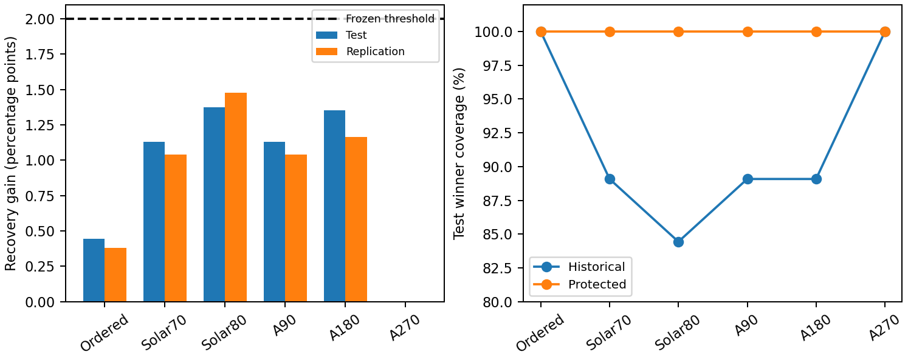
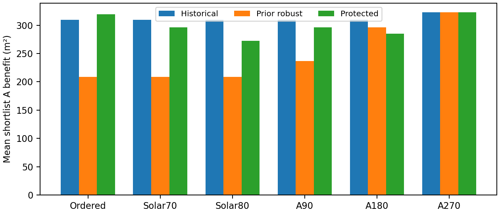

# 日照优先筛选：决策实验补充报告与修订选项

英文展开源文件SHA-256：c3b1a056d21e531ac0173208380335d6904dd77ac831303bef684159c1766c02。

本文件是同目录英文报告的完整中文忠实译稿。它不是新投稿论文；保留英文报告的全部章节、公式、图表与参考文献。参考文献保留正式原文题名便于核验，方法标识保留英文以便对照CSV。数字保留英文表内精度；完整精度见原始CSV。AI辅助范围见文末披露。

## 摘要

光权修复应先重视日照改善，再考虑最小化名义建筑干预。我们检验：在这一目标下，十个候选组成的清单能否比历史固定权重清单保留更多高排名备选。预先冻结的实验使用630个归档双建筑减高候选、三个约束权重空间、三个最低面积收益门槛，以及独立的训练、测试与重复验证权重。两个基于可接受性的选择器最大化经验前十恢复率，分别不保护或保护训练中出现的第一名。六个情景均未满足预先规定的替换历史方法条件：恢复率增益均低于0.02，部分清单的平均面积或时长收益下降超过设定保护线。不过，仍存在有用的条件性效果。在日照总权重至少70%的约束下，第一名覆盖率从89.08%升至100%，连续最坏归一化遗憾从0.019380降至0。在权重有序空间中，历史清单本来就有零遗憾。严格的面积门槛仅留下十二个候选，若只在子集中评价便会隐藏机会损失。这些是对归档表现开展的新决策分析，不是新的物理模拟。本补充报告保留先前论文，并给出基于证据的修订选项；它不是替代投稿稿件，也不声称提出新的通用算法。AI辅助已披露[openai2026]。

关键词：日照获取；决策支持；偏好敏感性；候选筛选；负面结果。

## 1 研究决策与范围

作者已明确项目目标：首先改善高密度既有街区的日照不足，其次偏好较小干预，最终设计选择留给建筑师。这与对全部收益—成本权重不加限制地讨论不确定性，是不同的决策约定。某方法保护了一个体量极低、日照收益却几乎没有的方案，在开放偏好模型下可能有用，却可能与光权修复不相符。本节使用AI辅助，范围见文末披露。

上一轮实验使用相同630个归档候选，发现在完整权重单纯形上，面向遗憾的贪心Robust10提高了机会保留能力。它也发现：在日照优先的有序空间和历史权重附近的局部空间，历史前十本来就是零遗憾；Robust10却恢复了更少偏好特定的前十成员。这些发现予以保留，不重新解释为在作者新优先目标下优越的证明。

本轮问题更窄：十个复核名额能否保留更多日照优先下的高排名方案，同时不丢失最佳方案，也不牺牲过多日照收益？答案必须由独立评价决定。预先规定的替换条件在所有情景中均失败。因此本报告记录新实验与修订选项，并保护先前正式论文。保留是一项存档决定，不是认可在新明确的研究定位下原样投稿。

结果并非“没有任何改善”。在重视时长的日照情景中，若干选择器改善了第一名覆盖率，所有新清单的经验恢复率均改善或持平。关键是区分可测量的条件收益，与更强的、预先规定的“新方法值得替换历史清单”主张。看到小幅增益后改成功门槛，会抹掉这一区别。

## 2 证据、指标与既有理论基础

### 2.1 冻结的物理证据

标准化研究模型含45个建筑组，其中36个满足归档的研究资格标记和高度条件。每个无序建筑对接受相同的固定足迹减高规则，得到组合数 C(36,2)=630 个候选。被选建筑高度为：

$$h_i^r=\max\{3,h_i-\min(3,0.25h_i)\}.\tag{1}$$

未选建筑高度和全部足迹保持不变。研究资格不代表拆除许可、产权评估或结构可行性结论。足迹来自构件包围盒的并集，存在已知重叠与表达限制，并非经核验的竣工实测边界。本节使用AI辅助，范围见文末披露。

归档直射日照时长使用2,031个接收点，网格间距3米、高度0.1米；采用接近冬至的2026年12月21日设计日情景，在08:15至15:45间设置十六个半小时时段中心。令D_j^0和D_j(i)分别为基准与候选时长。网格面积a=9平方米、P=2031、研究阈值τ=3小时，则：

$$A_i=a\sum_j[\mathbf1\{D_j^0<\tau\}-\mathbf1\{D_j(i)<\tau\}].\tag{2}$$
$$H_i=P^{-1}\sum_j[D_j(i)-D_j^0].\tag{3}$$
$$V_i=\sum_b |F_b|[h_b-h_b(i)].\tag{4}$$
$$N_i=a\sum_j\mathbf1\{D_j^0\geq\tau,\ D_j(i)<\tau\}.\tag{5}$$

因此A是低日照面积净减少量，H是平均日照时长增益，V是名义可加总移除体积，N是新增低日照面积。V既不是经核验的全场景实体并集体积变化，也不是测量的施工成本。日照阈值不被声称为法律合规检验。

新运行核实630行归档数据的N全部精确为0。它不再参与有效排名区分，但仍保留作设计转译有效性信号。全局归一化边界不变：A∈[0,396]平方米，H∈[0,0.06351551]小时，V∈[387.382435,10891.474418]立方米（印刷数值进行了舍入，计算保留归档完整精度）。过滤后不重新拟合边界。定义归一化收益：

$$x_i=(n_{A,i},n_{H,i},1-n_{V,i}),\qquad u_i(w)=w^\top x_i.\tag{6}$$

历史分值保持不变：

$$S_i=.45n_{A,i}+.35n_{H,i}+.15(1-n_{V,i})+.05(1-n_{N,i}).\tag{7}$$

其有效三指标中心是(9/19,7/19,3/19)，因为S_i=.95u_i(w^0)+.05。这一代数关系保留排序，不验证该权重是建筑师偏好。A与H相关却不同：归档Pearson相关为0.640978，Spearman相关为0.768360。前者指标测量阈值跨越，后者测量所有接收点的时长变化。

### 2.2 哪些属于成熟数学方法

多准则决策分析MCDA为多指标和不完全偏好提供成熟框架[GrecoEhrgottFigueira2016]。SMAA-2考察偏好条件下的排名可接受性[LahdelmaSalminen2001]，也已有成熟蒙特卡洛实现[TervonenLahdelma2007]。我们使用受限、表现固定的版本：抽样权重频率属于声明的积分测度性质，并不是现实建筑师偏好某方案的概率。

稳健序回归利用偏好信息限制相容的加性价值函数[GrecoMousseauSlowinski2008]。本研究没有建筑师成对比较的偏好访谈，因此施加权重不等式不等于拟合序回归模型。最小最大遗憾与代表性子集同样已有基础[BoutilierEtAl2006,NanongkaiEtAl2010]。不能自动把这些理论保证移植到本研究有限、归一化绝对遗憾实现中。

建筑性能优化、设计者主导的体量探索以及城市日照优化已有大量前例[NguyenReiterRigo2014,WangJanssenJi2024,LiHeZhao2024,LiuEtAl2023]。太阳能指标文献区分日照暴露、辐照、采光及其归一化[czachura2022metrics,compagnon2004urban]。这里可能的贡献，是在一个受约束干预案例中，明确日照优先决策定义，完成受控比较，并连接证据状态；不是发明SMAA、Pareto筛选、遗憾最小化或建筑师在环设计。

## 3 预先冻结的实验

### 3.1 日照优先的三种含义

协议在计算任何新门槛数量、抽样权重、排名或清单结果前提交。本节使用AI辅助，范围见披露。令W={w≥0:Σ_j w_j=1}，三个主要空间为：

$$W_O=\{w\in W:w_A\geq w_H\geq w_V\}.\tag{8}$$
$$W_{70}=\{w\in W:w_A+w_H\geq.70\}.\tag{9}$$
$$W_{80}=\{w\in W:w_A+w_H\geq.80\}.\tag{10}$$

有序权重使归一化面积系数高于时长与体量。日照总收益约束则限制体量系数，但允许时长优先于面积。两者都不是严格的日照字典序优化，也不保证最低物理面积收益。70%和80%是研究情景，不是行业标准。

三个分层情景先要求A≥90、180或270平方米，再使用W70。这些9平方米网格的整数倍门槛事先冻结，是最低收益情景，不是法规或专家调查阈值。过滤后分别剩166、50、12个候选；未过滤情景各有630个。提高门槛会排除其他方面有用的时长收益候选；较小空间内成功不能隐藏这种损失。

### 3.2 独立样本与同等名额

每个主要空间有20,000训练、20,000测试、20,000重复验证权重。NumPy PCG64生成float64独立同分布Dirichlet(1,1,1)抽样。将可交换坐标排序，得到有序扇区的面积均匀分布。以wV≤.30或.20进行拒绝抽样，每批100,000并按顺序保留接受样本，得到各截断单纯形的面积均匀分布。种子按ordered、Solar70、Solar80顺序：训练2026101901–03；测试2026101911–13；重复验证2026101921–23。分层情景复用完全相同Solar70数组，以进行配对比较，不把它们冒充额外独立偏好样本。共有180,000个唯一保留权重。

效用排序使用未舍入值，精确并列时按自然数字建筑对标识升序。六个对照方法均为十个名额。三个主要情景的Historical10、先前Robust10、AV10、AHV10都是不变归档清单。AV10、AHV10是各自Pareto前沿按历史排名截取的清单，不是经过优化的十项Pareto代表集。

过滤比较明确适配基线。Historical10取合格候选中历史排名最高十项；Robust10按原加入顺序保留合格旧成员，再按历史排名补足；AV10与AHV10在合格域重新计算前沿，按历史排名截取，不足时按历史排名补非前沿项。原清单违反门槛的情况单独保留。这些标为适配版，不把原清单悄悄重标成合格。所有过滤候选域均至少十项。

### 3.3 两个选择目标

T10(w)是偏好特定的确定性前十。十项集合S的期望恢复率为：

$$Q(S)=\mathrm E\left[\frac{|S\cap T_{10}(w)|}{10}\right]=\frac1{10}\sum_{i\in S}\Pr\{i\in T_{10}(w)\}.\tag{11}$$

期望的线性性使目标可加。Coverage10因此取训练前十出现次数最多的十项。并列先按训练第一名次数，再按较小训练平均排名，最后按自然建筑对标识。这是所述目标的精确经验优化，不是新通用算法，也不是总体恢复率最优证明。

ProtectedCoverage10额外要求纳入每个不同的确定性训练第一名，剩余名额按同样可接受性顺序填充。当必选集合至多十项时，这精确解决带约束的经验可加问题。若超过十项，冻结规则会报不可行，不临时创造退路。任何测试、重复验证、网格或连续审计第一名都不能修改选择。本次运行两方法在所有情景中成员相同：恢复率最优清单已含全部训练第一名。因此未观察到保护约束的增量收益。

恢复率不同于命中任意前十、第一名覆盖、建筑多样性或遗憾。合格候选域Dc下：

$$R_c(S,w)=\max_{i\in D_c}u_i(w)-\max_{s\in S}u_s(w).\tag{12}$$

清单可以零遗憾却恢复很少其他高排名候选。反之，仅最大化恢复率通常不能保证保住每个可能第一名。

### 3.4 评价、稳定性与主张门槛

独立评价报告确定性与基于效用的第一名覆盖、平均与观测最坏遗憾、恢复率、任意前十覆盖、清单及情景所选候选的A/H/V原值分布、归档复核覆盖。逐情景配对差异使用样本标准误和正态95%蒙特卡洛区间。这些区间描述固定输入及分布下的积分精度，不是跨场地或人类偏好不确定性。

每个选择器用十个互不相交的2,000权重训练分块独立重选清单。分块与完整清单、各分块两两的Jaccard交集比描述成员对训练样本的敏感性。诊断不修改完整训练清单。5,151点单纯形网格按各空间限制，独立于选择进行边界探测。

固定集合连续审计对每个合格候选i最大化：

$$\max_{w,t}t\quad\text{满足 }w\in W_c,\quad t\leq w^\top(x_i-x_s)\quad\forall s\in S.\tag{13}$$

再对i取最大值，得到固定清单与候选域的连续最坏遗憾。HiGHS原始与对偶容差10^-9；见证和直接遗憾在10^-8内检查。相同集合/空间/候选域去重后实际执行10,504次候选线性规划，对应12,708行带标签见证，全部成功。这是固定集合审计，不是清单构造全局最优证明。

分层情景将全域损失分解，不加隐藏：

$$F_c(w)=\max_{i\in D}u_i(w)-\max_{i\in D_c}u_i(w).\tag{14}$$
$$R_{\rm total}(S,w)=F_c(w)+R_c(S,w).\tag{15}$$

条件内零遗憾不等于相对全部630个候选零损失。

只有ProtectedCoverage10在测试与重复验证恢复率都至少提高0.02，配对区间下界为正；效用第一名覆盖下降不超过10^-4；平均与连续最坏遗憾增加不超过10^-8；并保留历史清单平均A和H各至少95%，协议才允许“支持替换”的主张。0.02和95%是声明的分析保护条件，不是专家验证标准；结果后未放松。普遍优越性要求所有可行情景均通过。

## 4 结果与替换假设失败

### 4.1 同名额比较

表1与2保留全部方法和情景。Coverage与Protected成员及结果相同，重复行记录保护无额外效果，不是两次独立成功。本节使用AI辅助，范围见披露。

表1：全部630候选的独立测试比较。所有清单恰有十项。最后一列是固定集合连续空间最大遗憾，不是测试抽样的最大损失。

| 情景 | 清单 | 恢复率 | 第一名覆盖 | 平均R | 连续最大R |
| --- | --- | --- | --- | --- | --- |
| Ordered | 历史 | 0.89495 | 1.0000 | 0.000000 | 0.000000 |
| Ordered | 先前稳健 | 0.44436 | 1.0000 | 0.000000 | 0.000000 |
| Ordered | AV | 0.29081 | 1.0000 | 0.000000 | 0.000000 |
| Ordered | AHV | 0.74141 | 1.0000 | 0.000000 | 0.000000 |
| Ordered | 覆盖 | 0.89938 | 1.0000 | 0.000000 | 0.000000 |
| Ordered | 保护覆盖 | 0.89938 | 1.0000 | 0.000000 | 0.000000 |
| Solar70 | 历史 | 0.64965 | 0.8908 | 0.000750 | 0.019380 |
| Solar70 | 先前稳健 | 0.45638 | 1.0000 | 0.000000 | 0.000000 |
| Solar70 | AV | 0.21158 | 0.6851 | 0.030440 | 0.232558 |
| Solar70 | AHV | 0.65683 | 1.0000 | 0.000000 | 0.000000 |
| Solar70 | 覆盖 | 0.66094 | 1.0000 | 0.000000 | 0.000000 |
| Solar70 | 保护覆盖 | 0.66094 | 1.0000 | 0.000000 | 0.000000 |
| Solar80 | 历史 | 0.65573 | 0.8444 | 0.001073 | 0.019380 |
| Solar80 | 先前稳健 | 0.45071 | 1.0000 | 0.000000 | 0.000000 |
| Solar80 | AV | 0.20581 | 0.6897 | 0.031419 | 0.232558 |
| Solar80 | AHV | 0.64956 | 1.0000 | 0.000000 | 0.000000 |
| Solar80 | 覆盖 | 0.66946 | 1.0000 | 0.000000 | 0.000000 |
| Solar80 | 保护覆盖 | 0.66946 | 1.0000 | 0.000000 | 0.000000 |

表2：各过滤候选域内部的分层比较。基线明确适配；条件遗憾不是相对全域损失。所有清单恰有十项。最后一列是固定集合连续最大遗憾，不是测试抽样最大损失。

| 情景 | 清单 | 恢复率 | 第一名覆盖 | 平均R | 连续最大R |
| --- | --- | --- | --- | --- | --- |
| A90 | 历史 | 0.64965 | 0.8908 | 0.000750 | 0.019380 |
| A90 | 先前稳健 | 0.52989 | 1.0000 | 0.000000 | 0.000000 |
| A90 | AV | 0.21158 | 0.6851 | 0.030440 | 0.232558 |
| A90 | AHV | 0.65683 | 1.0000 | 0.000000 | 0.000000 |
| A90 | 覆盖 | 0.66094 | 1.0000 | 0.000000 | 0.000000 |
| A90 | 保护覆盖 | 0.66094 | 1.0000 | 0.000000 | 0.000000 |
| A180 | 历史 | 0.69329 | 0.8908 | 0.000750 | 0.019380 |
| A180 | 先前稳健 | 0.70456 | 1.0000 | 0.000000 | 0.000000 |
| A180 | AV | 0.60172 | 0.8908 | 0.000750 | 0.019380 |
| A180 | AHV | 0.70680 | 1.0000 | 0.000000 | 0.000000 |
| A180 | 覆盖 | 0.70680 | 1.0000 | 0.000000 | 0.000000 |
| A180 | 保护覆盖 | 0.70680 | 1.0000 | 0.000000 | 0.000000 |
| A270 | 历史 | 0.99662 | 1.0000 | 0.000000 | 0.000000 |
| A270 | 先前稳健 | 0.99662 | 1.0000 | 0.000000 | 0.000000 |
| A270 | AV | 0.90000 | 1.0000 | 0.000000 | 0.000000 |
| A270 | AHV | 0.90000 | 1.0000 | 0.000000 | 0.000000 |
| A270 | 覆盖 | 0.99662 | 1.0000 | 0.000000 | 0.000000 |
| A270 | 保护覆盖 | 0.99662 | 1.0000 | 0.000000 | 0.000000 |

Historical10仍是强有力的有序优先基线：测试恢复率0.894950，每种偏好保有第一名，连续遗憾为0。新清单提高到0.899380，仅增加0.004430。先前Robust10保住同一个第一名，但有序前十平均仅恢复0.444360。这具体说明保留一个机会与提供多个高排名方案有区别。

Solar70下，Historical10测试第一名覆盖0.89080、平均遗憾0.000750、连续最坏遗憾0.019380。ProtectedCoverage10实现测试第一名全覆盖与连续零遗憾，恢复率从0.649650升至0.660935。Solar80同样把第一名覆盖从0.84435升至1，恢复率从0.655725升至0.669465。更高日照总权重不使历史排序普遍充分：Solar80仍允许接近纯时长偏好。之前有序空间零遗憾不能推广到这个不同支撑空间。

AHV10在Solar70和Solar80也为零遗憾。因此弥补历史清单漏掉第一名并非新选择器独有。其恢复率分别为0.656835和0.649560，仍不同。AV10在强烈重视时长时表现不佳，说明只按面积、体量筛选而忽略第二日照指标的代价。

图1：由保存CSV计算的新结果。左：两个独立分组中保护清单恢复率增益都低于冻结的两个百分点门槛。右：即使更强替换条件失败，部分情景仍有真实第一名覆盖收益。

### 4.2 小幅增益、重复验证与日照权衡

表3：保护版减去历史版的恢复率差异，含测试配对蒙特卡洛区间、重复验证增益及清单原值平均日照变化。冻结替换门槛为两个独立分组各至少提高0.02。

| 情景 | 测试增益 | 测试95%蒙特卡洛区间 | 重复验证增益 | A变化 | H变化 |
| --- | --- | --- | --- | --- | --- |
| Ordered | 0.00443 | [0.00307, 0.00579] | 0.00381 | +3.20% | -8.23% |
| Solar70 | 0.01128 | [0.01001, 0.01256] | 0.01038 | -4.36% | +5.79% |
| Solar80 | 0.01374 | [0.00972, 0.01776] | 0.01477 | -11.92% | +18.13% |
| A90 | 0.01128 | [0.01001, 0.01256] | 0.01038 | -4.36% | +5.79% |
| A180 | 0.01350 | [0.01094, 0.01607] | 0.01164 | -7.85% | +9.68% |
| A270 | 0.00000 | [0.00000, 0.00000] | 0.00000 | +0.00% | +0.00% |

没有情景通过完整替换规则。表3表明：五个情景恢复率差异为正，蒙特卡洛区间甚至排除0，但按预定实际门槛仍不够大。统计积分精度不等于实际重要性。A270历史与保护集合完全没有差异。

有序清单把C12/C24替换为C9/C28。平均面积收益上升，但平均时长收益约下降8.2%，未通过95%时长保护。Solar80中三个替换提高时长收益，却使平均面积收益约下降11.9%，平均名义体量增加。这不是各指标均改善日照修复的证据，也不是节省成本结果。A180同样未过面积保护。Solar70与A90通过原值均值日照保护，却仍未达恢复率改善门槛。

图2：清单平均原始面积收益。主要情景使用不变的历史与先前稳健清单；分层情景使用明确适配版。高第一名覆盖不意味着十项都有强面积收益。

清单平均表现不是同时建设十项干预的结果，因为建筑师会从备选中选择。它在此作为声明的保护条件，避免提供总体日照较弱的菜单。还保留逐情景清单内最佳候选的分布，它可能与列表均值不同。两种摘要都不能代替逐项评审，也不能证明人类决策质量。

### 4.3 硬性最低收益的影响

A90排除464项，但历史与新Solar70成员不变，所以条件比较与Solar70相同。A180剩五十项，改变若干适配基线；ProtectedCoverage10在这里与AHV10相同。这是独立、明确过滤的决策域。

A270只剩十二项。Historical、先前Robust、Coverage、Protected适配版成为同一十项集合，测试恢复率0.996625、条件遗憾0。AV10和AHV10仍不同，恢复率0.900000，不能说与前四者相同。更重要的是，Solar70测试权重下，A270过滤本身相对全域机会损失平均约0.030440、观测最大约0.228607。重时长偏好可能在清单选择前就失去有价值候选。近乎完美的条件恢复率部分反映候选域变小，不是方法普遍优越。

没有根据这些结果事后选“最好”阈值。建筑师可以合理设最低面积收益，但须知道这是实质项目要求，也可能牺牲时长机会。本实验揭示这一选择，而不替建筑师授权。

### 4.4 成员稳定性与证据负担

表4：保护清单原值均值、归档证据覆盖及训练分块成员稳定性。HB指规则层Honeybee复核；转译是独立几何证据阶段。

| 情景 | A | H | V | HB | 转译 | J均值 | J最小 |
| --- | --- | --- | --- | --- | --- | --- | --- |
| Ordered | 319.5 | 0.03900 | 4378.8 | 9/10 | 3/10 | 1.000 | 1.000 |
| Solar70 | 296.1 | 0.04495 | 4427.4 | 9/10 | 3/10 | 0.945 | 0.818 |
| Solar80 | 272.7 | 0.05020 | 5350.6 | 7/10 | 2/10 | 0.894 | 0.667 |
| A90 | 296.1 | 0.04495 | 4427.4 | 9/10 | 3/10 | 0.945 | 0.818 |
| A180 | 285.3 | 0.04660 | 4388.6 | 9/10 | 4/10 | 0.891 | 0.818 |
| A270 | 323.1 | 0.03609 | 4288.0 | 8/10 | 3/10 | 1.000 | 1.000 |

保护版ordered与A270在所有训练分块相同。Solar70与A90的分块—完整清单平均Jaccard为0.945455；Solar80为0.893939、最小0.666667；A180为0.890909。平均恢复率小幅变化可以伴随边缘成员变动。分块测的是数值抽样敏感性，不是重复建筑项目或用户。

表5：Solar70保护清单示例，不是新批准替代版。成员相对Historical10仅以C24/C35替换C9/C27。位置来自选择记录，不是最终建筑推荐。

| 建筑对 | 旧排名 | A | H | V | 规则HB | 转译 |
| --- | --- | --- | --- | --- | --- | --- |
| C9/C24 | 1 | 396 | 0.04874 | 5551.3 | 有 | 有 |
| C12/C24 | 7 | 198 | 0.06228 | 4919.3 | 有 | 缺失 |
| C24/C35 | 11 | 189 | 0.06352 | 6192.0 | 缺失 | 缺失 |
| C15/C24 | 4 | 243 | 0.05367 | 4016.5 | 有 | 缺失 |
| C9/C12 | 3 | 306 | 0.04357 | 4030.5 | 有 | 缺失 |
| C9/C35 | 5 | 297 | 0.04481 | 5303.3 | 有 | 缺失 |
| C9/C15 | 2 | 351 | 0.03496 | 3127.8 | 有 | 有 |
| C9/C26 | 9 | 315 | 0.03520 | 3906.1 | 有 | 缺失 |
| C9/C13 | 6 | 333 | 0.03028 | 2975.2 | 有 | 有 |
| C9/C21 | 8 | 333 | 0.03250 | 4252.0 | 有 | 缺失 |

Solar70特别清楚展示有用的次要发现：C24/C35替换C9/C27，加入归档时长增益最大的候选，但无归档规则HB结果。ordered引入未复核C9/C28；Solar80含未复核C24/C35、C24/C27、C24/C26；A180仍缺C24/C35复核。甚至A270历史适配版也含未复核C9/C28与C9/C20，因为它已不是原来全部经过策划复核的历史十项。过滤或优化清单不能仅凭方法名称继承验证。

## 5 模拟与几何保持为不同证据

新计算仅是归档A/H/V/N的决策分析，没有执行新的Honeybee/Radiance模拟、实地测量、建筑师研究或施工评估。原23个选择性规则复核与冻结20个同场地覆盖样本均保留，未重选。共43个已复核建筑对，不代表630项全验证。本节使用AI辅助，范围见披露。

归档覆盖队列中，面积一致性Spearman相关0.997668，平均绝对差0.45平方米，来自二十项中一项9平方米差异。这不是亚网格物理精度。历史分值一致性部分因为两路线共享名义V和恒定N。Honeybee与筛选路线的有效太阳射线也不同；汇总一致性不建立物理输入相同，更不推广到未复核组合。

历史转译几何是另一个阶段。五个归档转译中四个未满足实体包含性。受控纠错在冻结射线与接收点下消除了观测到的新增遮挡事件。C9/C24纠正转译的面积收益351平方米，规则筛选值396平方米；C9/C15纠正转译保留342平方米，规则值351平方米。这些值对应不同几何，不能在决策表中互换。

先前测得约483倍实现速度比，是两个未索引单线程Python实现、匹配几何基元输入下的比较。它支持快速有限筛选的可行性，不证明优于有索引求解器，不是新模拟，也不是建筑师工作时间减少的实测。Ladybug、Radiance提供成熟模拟背景[roudsari2013ladybug,ward1994radiance]；名称不能为输入几何或干预方案背书。

证据顺序仍是：规则候选、选择性专业模拟复核、转译设计及包含性检查，然后结构、法律与施工可行性。建筑师可借清单集中注意力，但不能从高分、零模型遗憾或前一阶段勾选项推断后一阶段完成。

## 6 解读与论文修订选项

### 6.1 回答决策问题

新选择器更明确地提供一种决策服务：在声明的日照优先偏好下保留多个高排名方案，而不是接受一个未经验证的权重向量。它有可解释性，却不证明推荐普遍更好。本实验收益太小，或日照权衡过大，未满足约定替换规则。本节使用AI辅助，范围见披露。

如果Historical10已含全部第一名，例如有序空间，新集合只能通过保留更多近优选项、降低复核负担、改善原始表现等其他服务增加价值。这里恢复率增益小且平均时长下降超保护线，不足以成为有力替换理由。相反，Solar70和Solar80下Historical10确实漏了部分时长优先第一名。补这些机会是真实条件收益，但AHV10与先前Robust10也保留它们，新恢复率改善仍未过预定门槛。

旧广域Robust10平均名义体量更低，但主要情景平均面积收益比Historical10低很多，分别208.8与309.6平方米。这不使之前完整单纯形遗憾结果失实，而说明不限制的成本主导偏好回答了不同于日照优先修复的问题。正确做法是让偏好模型对齐项目，而不是宣传来自不适合权重区域的最大数值增益。

### 6.2 应保留或修改什么

**保守路线。** 保留历史清单作默认复核列表，加上新测敏感性与证据状态。将研究描述为日照优先可解释筛选与决策支持。贡献是明确约束决策模型、受控比较，以及一个看似合理的新选择器未通过更强替换检验的经验发现。不能因此说45/35/15/5已成专家认可或普遍最优。

**条件路线。** 如果建筑师明确接受允许时长主导的日照总权重空间，可提供对应清单作可选比较。Solar70替换容易解释，使用于设计前值得先给C24/C35补规则模拟复核。这是次要机会保留发现，不推翻恢复率替换检验失败。选择此路线需要作者决定实际决策服务，而不是事后放松门槛。

**进一步研究。** 获取真实项目偏好与拒绝约束，检查完整文献，只有授权输入与环境具备时才补缺专业模拟，研究建筑师是否受益于清单。这会产生新证据，不能说本次偏好实验已完成。

本次交付不替换为新的正式投稿稿。先前英文论文与中文版保留原位置。本补充报告、完整结果与修订选项让作者先选择合理定位，再委托最终论文修订。现有论文广域叙事不应原样提交并当作日照优先优越性的证明。

### 6.3 局限与可复现性

分析使用一个简化场地、一种固定规则族、单日、粗接收网格与固定归档表现。权重均匀分布、归一化、收益门槛和决策标准均为研究者声明。相关日照指标仍允许补偿；原V不含实际成本、搬迁、权利及社会影响。新权重种子不产生新场地证据。重复评价多个情景不将条件蒙特卡洛区间变成控制多重检验的科学发现检验。

全部比较保留十名额、选择评价分离及不利结果。档案含输入哈希、结果前协议、软件和运行日志、权重、排名成员、候选可接受性、选择轨迹、连续见证、逐情景指标、稳定性与证据状态。图表直接由保存输出生成。物理原数据与私有仓库仍受限，不主张公开复现权限。作者仍须检查数据权利、原创性、AI辅助、匿名及投稿声明。

## 7 结论

六个预先声明情景均不支持按完整冻结规则替换Historical10。两个独立分组恢复率改善均小于0.02，部分情景清单牺牲过多平均面积或时长收益。最有用的次要结果，是日照总权重空间中更完整的第一名保留，包括新清单连续条件零遗憾。最重要的警示是：硬面积门槛可能使过滤内表现很好，却排除有价值的时长优先机会。本节使用AI辅助，范围见披露。

建筑师应先明确优先是指标有序、日照总重视，还是明确最低面积改善。再查看少量有注释候选，比较敏感性，要求补模拟或几何证据，决定深化哪项干预。实验支持这种透明流程与谨慎默认选择，不支持虚构算法突破或施工就绪推荐。

## AI使用披露

OpenAI助手[openai2026]实质性辅助了摘要及第1至7节的协议与代码准备、文献和证据组织、分析报告、公式、写作、图表、翻译准备和LaTeX质量检查。章节引用标明辅助文本。图表来源于保存计算结果，没有用合成观测替代缺失物理证据。未记录确切底层模型版本。本声明不声称作者已完成独立验证；作者须确认辅助范围与适用声明。暂用不含身份的披露，因为官方AI披露与匿名致谢指引之间的处理方式须由作者在投稿前澄清。

## 参考文献

下列原文书目信息逐条保留自英文编译稿，保持题名、作者与DOI可核验；引用键与正文一致。

[BoutilierEtAl2006] Boutilier, C., Patrascu, R., Poupart, P., Schuurmans, D.: Constraint-based optimization and utility elicitation using the minimax decision criterion. Artificial Intelligence 170(8–9), 686–713 (2006). https://doi.org/10.1016/j.artint.2006.02.003

[compagnon2004urban] Compagnon, R.: Solar and daylight availability in the urban fabric. Energy and Buildings 36(4), 321–328 (2004). https://doi.org/10.1016/j.enbuild.2004.01.009

[czachura2022metrics] Czachura, A., Kanters, J., Gentile, N., Wall, M.: Solar performance metrics in urban planning: A review and taxonomy. Buildings 12(4), 393 (2022). https://doi.org/10.3390/buildings12040393

[GrecoEhrgottFigueira2016] Greco, S., Ehrgott, M., Figueira, J.R. (eds.): Multiple Criteria Decision Analysis: State of the Art Surveys, International Series in Operations Research and Management Science, vol. 233. Springer, 2 edn. (2016). https://doi.org/10.1007/978-1-4939-3094-4

[GrecoMousseauSlowinski2008] Greco, S., Mousseau, V., Słowiński, R.: Ordinal regression revisited: Multiple criteria ranking using a set of additive value functions. European Journal of Operational Research 191(2), 415–435 (2008). https://doi.org/10.1016/j.ejor.2007.08.013

[LahdelmaSalminen2001] Lahdelma, R., Salminen, P.: SMAA-2: Stochastic multicriteria acceptability analysis for group decision making. Operations Research 49(3), 444–454 (2001). https://doi.org/10.1287/opre.49.3.444.11220

[LiHeZhao2024] Li, J., He, Z., Zhao, B.: A novel method of high-density urban block form generation based on multi-objective solar performance optimization: A case study of nanjing. Energy and Buildings 324, 114878 (2024). https://doi.org/10.1016/j.enbuild.2024.114878

[LiuEtAl2023] Liu, K., Xu, X., Zhang, R., Kong, L., Wang, W., Deng, W.: Impact of urban form on building energy consumption and solar energy potential: A case study of residential blocks in jianhu, china. Energy and Buildings 280, 112727 (2023). https://doi.org/10.1016/j.enbuild.2022.112727

[NanongkaiEtAl2010] Nanongkai, D., Das Sarma, A., Lall, A., Lipton, R.J., Xu, J.: Regret-minimizing representative databases. Proceedings of the VLDB Endowment 3, 1114–1124 (2010). https://doi.org/10.14778/1920841.1920980

[NguyenReiterRigo2014] Nguyen, A.T., Reiter, S., Rigo, P.: A review on simulation-based optimization methods applied to building performance analysis. Applied Energy 113, 1043–1058 (2014). https://doi.org/10.1016/j.apenergy.2013.08.061

[openai2026] OpenAI: OpenAI assistant. https://openai.com/ (2026), AI-assisted drafting and editing tool; exact underlying model/version not recorded. Used October 2026

[roudsari2013ladybug] Sadeghipour Roudsari, M., Pak, M.: Ladybug: A parametric environmental plugin for Grasshopper to help designers create an environmentally-conscious design. In: Proceedings of BS2013: 13th Conference of International Building Performance Simulation Association. pp. 3128–3135 (2013). https://doi.org/10.26868/25222708.2013.2499

[TervonenLahdelma2007] Tervonen, T., Lahdelma, R.: Implementing stochastic multicriteria acceptability analysis. European Journal of Operational Research 178(2), 500–513 (2007). https://doi.org/10.1016/j.ejor.2005.12.037

[WangJanssenJi2024] Wang, L., Janssen, P., Ji, G.: Optimization-based design exploration of building massing typologies—EvoMass and a typology-oriented computational design optimization method for early-stage performance-based building massing design. Frontiers of Architectural Research 13(6), 1400–1422 (2024). https://doi.org/10.1016/j.foar.2024.06.001

[ward1994radiance] Ward, G.J.: The RADIANCE lighting simulation and rendering system. In: Proceedings of the 21st Annual Conference on Computer Graphics and Interactive Techniques. pp. 459–472. ACM (1994). https://doi.org/10.1145/192161.192286
