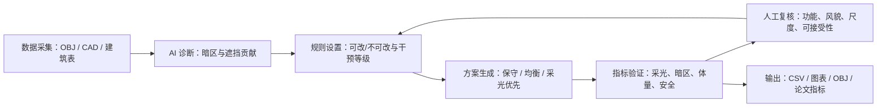

# 光环境修复 AI 空间决策助手：PRD 草案

更新时间：2026-06-02

## 1. 产品定位

产品名称：光环境修复 AI 空间决策助手

英文工作名：AI Spatial Decision Copilot for Light Equity Restoration

产品定位：

面向旧街区更新早期方案阶段，把现场调研、建筑体块模型、可改/不可改约束、采光诊断、候选干预生成、指标验证和人工复核串成一套可复用工作流。

本产品不宣称 AI 替代人工设计，也不宣称输出施工级日照审查结果。它的价值是帮助设计团队更快发现暗区、定位遮挡贡献对象、生成可讨论的最小干预候选，并把每轮方案转化为可复核指标。

## 2. 目标用户

- 建筑学/城市设计学生团队；
- 课程设计导师；
- 旧城更新前期研究团队；
- 需要快速比较体块策略的方案设计师；
- 希望把空间调研转成数据化决策流程的建筑科技方向研究者。

## 3. 核心痛点

| 痛点 | 传统做法的问题 | 产品回应 |
| --- | --- | --- |
| 暗区判断依赖经验 | 容易停留在感性描述 | 输出热力图、暗区 CSV 和指标 |
| 模型和表格难协同 | CAD、SU、Excel 对不上 | 用 C1-C45 编号和 CSV 数据合同统一对象 |
| 方案修改慢 | 每次修改后难快速复核 | ABC 流程自动生成候选和对比指标 |
| 老街区限制复杂 | 哪些能改常常说不清 | 引入人工可改/不可改规则表 |
| AI 结果难解释 | 只给一个答案难以说服老师 | 输出保守/均衡/采光优先多策略候选 |

## 4. 产品闭环

## 5. 功能模块

### M1 数据导入

输入：

- `site_model.obj`
- `buildings.csv`
- `streets.csv`
- `nodes.csv`
- `protected_zones.csv`
- 可选：`site_zones.csv`、`road_segments.csv`、照片索引

输出：

- 数据完整性检查；
- 建筑编号一致性检查；
- 可运行数据集。

### M2 光环境诊断

对应算法 A。

功能：

- 生成冬至日 8:00-16:00 简化采光小时数；
- 标记暗区；
- 输出暗区坐标；
- 识别可改善缝隙和相关建筑。

### M3 规则设置

这是人机协同的关键模块。

人负责输入：

- 可干预建筑；
- 不可干预建筑；
- 不可改原因；
- 可选干预等级 0-4。

AI 不自动判断历史保护、产权、公共服务和风貌价值，只读取人工约束。

### M4 方案生成

对应算法 B。

生成三种产品策略：

- 保守型：最小体量变化，优先减少风险；
- 均衡型：兼顾采光改善和改造体量；
- 采光优先型：探索较高采光改善潜力，供人工复核。

### M5 指标验证

对应算法 C 和 final report。

验证：

- 平均采光小时；
- 暗区比例；
- 严重暗区数量；
- 干预体量；
- 涉及建筑数量；
- 是否触碰不可动/保护对象；
- 可通达与安全基础指标。

### M6 人工复核

人工复核不是附属步骤，而是产品闭环的一部分。

复核内容：

- 是否违反任务书；
- 是否影响幼儿园、公共服务、风貌建筑；
- 是否空间尺度突兀；
- 是否能转译成建筑设计语言；
- 是否需要调整可改/不可改规则并重新运行。

## 6. 当前 MVP 范围

当前 MVP 只服务沿湖休闲片区。

已具备：

- C1-C45 建筑编号；
- SU/OBJ 白模；
- 建筑高度表；
- 幼儿园 C42 不可动；
- 暗区诊断；
- 算法候选生成；
- 安全验证；
- 输出 CSV、PNG、OBJ 和 JSON。

仍需组员补充：

- 每栋建筑是否可干预；
- 不可干预原因；
- 可选干预等级；
- 人工对候选方案的空间复核意见。

## 7. 成功指标

工程成功：

- 数据集可一键运行；
- 新增可改/不可改列表后算法自动更新候选；
- 保守/均衡/采光优先三策略可输出结果；
- 输出文件能直接服务论文和汇报。

研究成功：

- 能解释 AI 介入设计流程的位置；
- 能说明哪些判断由人完成、哪些计算由 AI 完成；
- 能形成可复用的数据结构和工作流；
- 能避免“AI 比人工强”这种不稳妥表述。

## 8. 产品一句话

本项目是一个面向旧街区光环境修复的 AI 空间决策助手：它把建筑调研数据转化为可计算对象，在人工设定的可干预边界内进行采光诊断、最小干预候选生成和指标验证，最终为建筑设计团队提供可复核的方案决策依据。
